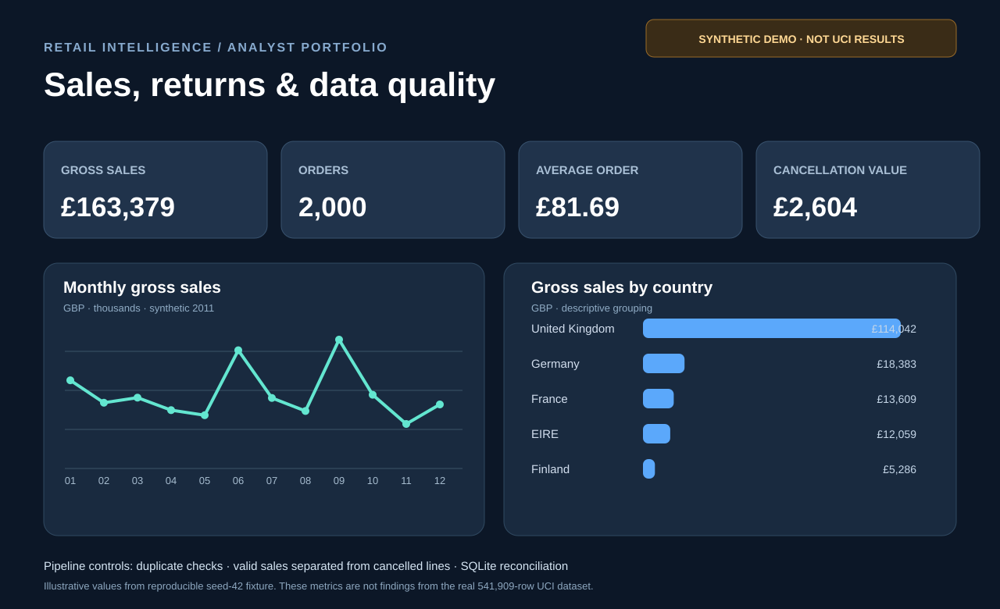

# Retail Sales & Returns — Google Data Analytics Case Study

**Ask → Prepare → Process → Analyze → Share → Act** | Python · SQL · R · dashboards · data quality

> **Status:** Reproducible, locally tested case-study pipeline with a synthetic demonstration. The full 541,909-row UCI dataset can be retrieved using the included downloader when internet access is available. **Synthetic demonstration figures are not real dataset findings.**



## The business question

A retail analyst is asked to explain historic monthly sales patterns, leading markets and products, and data-quality risks in transaction exports. Can management trust the raw data? What cannot be inferred from it?

## What this repository demonstrates

- Clear metric definitions for gross sales, orders, average order value, and cancellation-line value.
- Data cleaning and quality checks: types, missing data, exact duplicates, and cancellations.
- Python/Pandas and SQLite reconciliation of key financial KPIs.
- Reproducible CSV reports, visualizations, unit tests, and GitHub Actions CI.
- Optional base R verification and a Power BI model blueprint (not a claim of a deployed PBIX).
- Business-ready conclusions that separate verified findings from limitations.

## Data source and attribution

**Daqing Chen (2015), UCI Online Retail**, DOI [10.24432/C5BW33](https://doi.org/10.24432/C5BW33), [UCI dataset](https://archive.ics.uci.edu/dataset/352/online+retail), CC BY 4.0. The public dataset describes **541,909 historical transaction lines from a UK non-store retailer, 2010–2011**, not HOK-Elanto or any other Finnish company.

Source files are fetched into the Git-ignored `data/raw/` folder and are not redistributed here.

## Quick start

```bash
python -m venv .venv
source .venv/bin/activate
pip install -r requirements.txt
python scripts/make_demo.py
python analysis/pipeline.py --input data/synthetic_retail_demo.csv --out output/demo
python -m unittest discover -s tests -v
```

For real public data:

```bash
python scripts/download_uci.py
python analysis/pipeline.py --input "data/raw/Online Retail.xlsx" --out output/uci
```

Generated outputs: `quality_and_kpis.json`, `monthly_sales.csv`, `country_sales.csv`, `top20_products.csv` and two PNG charts. No cloud keys or paid APIs are needed.

## Portfolio reading guide

1. [Business question and data dictionary](docs/DATA_DICTIONARY.md)
2. [Google capstone mapping](docs/GOOGLE_CAPSTONE_MAPPING.md)
3. [Reproducibility and evidence boundaries](docs/REPRODUCIBILITY.md)
4. [Data pipeline](analysis/pipeline.py) and [tests](tests/test_pipeline.py)
5. [Power BI model blueprint](dashboard/POWER_BI_MODEL.md)
6. [Finnish management summary](docs/JOHDON_YHTEENVETO_FI.md)

## Evidence integrity

This is a **new independent case study developed after completing the Google Data Analytics Professional Certificate in 2025**; it was not submitted to Coursera as that certificate's assessed work. The local Python tests passed (5/5) before publication. The official full UCI dataset analysis and a deployed Power BI report **remain to be independently verified**. The demo visual is synthetic and is not a measurement of the UCI dataset.

### Provenance

**COPIED:** none. Pipeline, tests and documentation were authored for this portfolio. **ADAPTED:** analytical framework from Google's published capstone phases. **DATA:** attributed external UCI Online Retail dataset under CC BY 4.0, downloaded independently by the user when running the project. **NOT VERIFIED:** full 541,909-row source run, deployed PBIX, optional R results.
