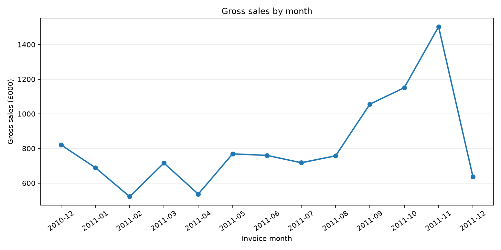
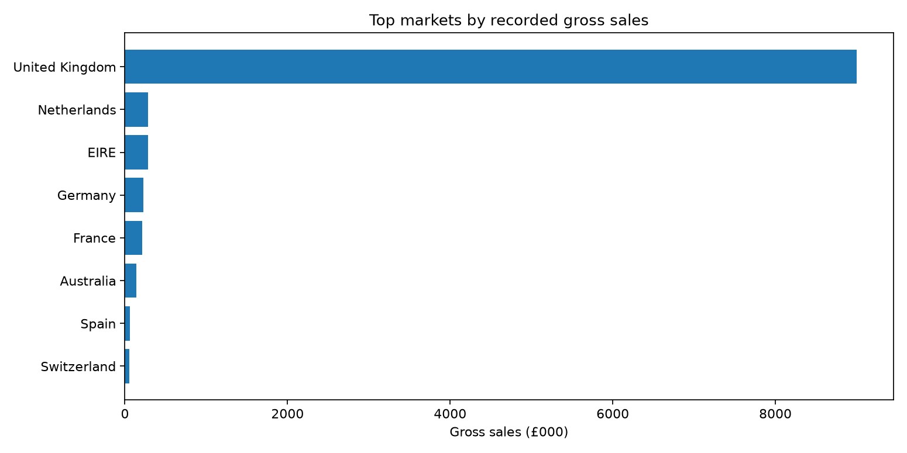

# Real UCI Online Retail — validated descriptive analysis

**Data source:** Chen, D. (2015), Online Retail, UCI, CC BY 4.0, DOI 10.24432/C5BW33. Historical UK non-store retailer, 2010–2011.
**Source SHA-256:** 43465a06f2ccf7c8b5bd2892bc7defb52f97487934fe93b16ae4c3936424676d. **Original rows:** 541,909. **SQL/Pandas check:** PASS.

| Measure | Observed value | Definition |
|---|---:|---|
| Gross sales | £10,642,110.80 | Positive non-cancelled sale lines before returns and costs |
| Distinct sale invoices | 19,960 | Invoice-based order count |
| Average order value | £533.17 | Gross sales / orders |
| Cancellation line value | £893,979.73 | Separately reported; not netted |
| Valid sale lines | 524,878 | Post-cleaning sales |
| Exact duplicate rows | 5,268 | Excluded before metrics |
| Rows missing CustomerID | 135,080 | Not assumed to be unique persons |
| Distinct sales markets | 38 | Country values in sale lines |

**Limitations:** Historical descriptive analysis only. Profit, causality, current Finnish retail
performance and 2026 market conditions are not established. No row-level identifiers are published.
